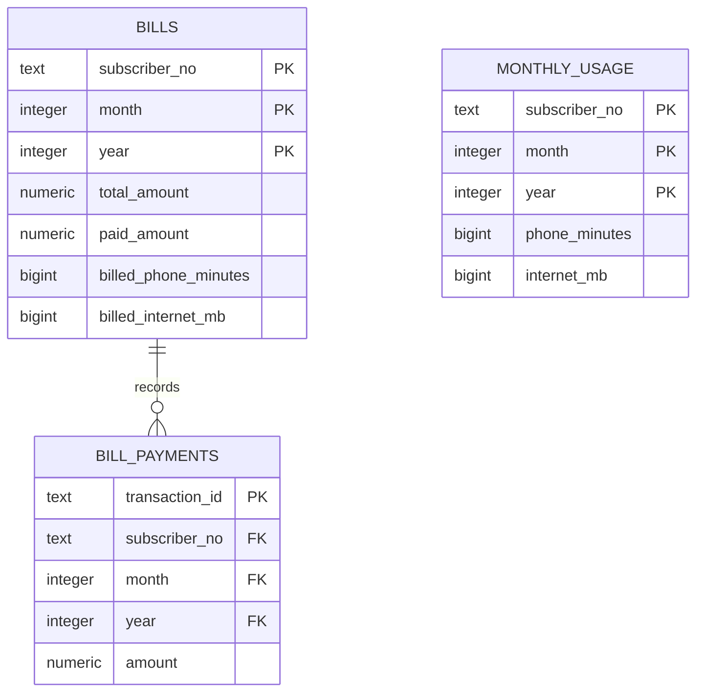

# AI Billing Support Assistant

AI Billing Support Assistant is a chat application for a fictional mobile
provider. A demo subscriber can ask about pricing rules, check a monthly bill,
see what caused extra charges, and confirm a simulated payment. The assistant
retrieves policy information through MCP and reads billing records through a
REST API. To explain a specific charge, it combines both sources.

## Demonstration Video

[Watch the demo on Google Drive](https://drive.google.com/file/d/1VWfZQHFZLBWBD38UBQXhM96rx9u5SJxE/view?usp=sharing)

## Architecture and API specification

The browser and terminal run the billing agent, which asks Gemini to select
tools. Policy lookups use the MCP server over stdio. Billing operations go
through NGINX to FastAPI and PostgreSQL.

- [OpenAPI specification](openapi.json) generated by FastAPI
- [PostgreSQL schema](schema.sql)

### Database ER diagram



Bill calculation looks up monthly usage by subscriber, year, and month. A
bill saves a snapshot of the usage applied to that calculation. The composite
foreign key on payments references the corresponding bill.

## Add Usage

`POST /api/v1/usage` takes a JSON body with `subscriber_no`, `month`, `year`,
and `usage_type`. `Phone` adds 10 minutes and `Internet` adds 1 MB to the
subscriber's total for that month. A successful request returns HTTP 200 with
`{"status":"success"}`. Each accepted request adds usage again.

The endpoint uses an operator bearer token from `USAGE_OPERATOR_TOKEN`. This
credential is for the trusted mobile provider operator, who can record usage
for any subscriber. Keep it out of source control and subscriber-facing clients.
Requests with missing or invalid credentials receive HTTP 401 when configured.
The endpoint returns HTTP 503 if the server has no token configured.

For the local setup, load the token from the private, ignored `.usage-token`
file when starting Uvicorn. In Swagger UI, select **Authorize** and paste the
token value. Apply `schema.sql` to the database before using the endpoint.

```sh
DATABASE_URL='host=/tmp dbname=billing' USAGE_OPERATOR_TOKEN="$(cat .usage-token)" \
  .venv/bin/python -m uvicorn main:app --host 127.0.0.1 --port 8001
```

## Calculate Bill

`POST /api/v1/bills/calculate` accepts `subscriber_no`, `month`, and `year`
in a JSON body and uses the same operator token as Add Usage. It returns
HTTP 200 with `{"status":"success"}` after saving the bill. Use Query Bill
to read the saved amount.

The first 1,000 phone minutes are free. Each started block of 1,000 extra
minutes costs $10. Internet costs $50 through 20 GB, plus $10 per started
extra 10 GB block (1 GB = 1,000 MB). The $50 base applies even in a month
with zero usage. If the selected month has no usage record, the bill uses zero
phone minutes and zero MB for a subscriber with an existing usage or bill
record. This project uses those records to identify known subscribers. A
subscriber with neither record receives HTTP 404.
Recalculation preserves payments and returns HTTP 409 if
the new total would be lower than the amount already paid.

## Query Bill Detailed

`GET /api/v1/bills/{subscriber_no}/details` requires the operator token and
the `month` and `year` query parameters. It returns the bill summary, billed
phone minutes, billed internet in MB and GB, and a page of charge items.
`page` starts at 1. `page_size` defaults to 10 and accepts 1 through 100.
`total_items` is the number of charge items across all pages.

Apply `schema.sql` before deploying the updated API. Calculate Bill now
saves the usage used to calculate each invoice. Usage added afterward shows
up in the invoice details after recalculation. Existing invoices without
recorded billed usage return null usage and a single `unitemized` charge
equal to the stored bill total.

## Pay Bill

`POST /api/v1/bills/pay` simulates a partial or full payment. In Swagger,
authorize with the operator token and send `subscriber_no`, `month`, `year`,
`amount`, a unique `transaction_id`, and `confirmed: true` after explicitly
confirming the payment. Amounts must be positive and have at most two decimal
places. The transaction ID is case-sensitive and may contain letters, digits,
hyphens, or underscores.

The response includes the transaction status, cumulative `paid_amount`, and
`remaining_balance`. Duplicate IDs and payments above the balance receive
HTTP 409. A missing bill receives HTTP 404 and explicitly declining confirmation
receives HTTP 400. Apply `schema.sql` to create the payment table. The payment
record and balance update commit in a single PostgreSQL transaction.

## API tests

From the project directory, install the test dependencies and run pytest:

```sh
.venv/bin/python -m pip install -r requirements-dev.txt
.venv/bin/python -m pytest -q
```

The tests send requests through FastAPI's test client and mock the PostgreSQL
connection. They cover bill retrieval and validation, both usage increments,
missing or invalid operator credentials, an unsupported usage type, and
bill calculation tariff boundaries, and detailed bill authorization,
paging, legacy invoices, and partial and full payments with failure cases.
They can run without a PostgreSQL server or a live LLM.

Verified result: `33 passed`.

## Billing guide MCP demo

The MCP server uses the official Python SDK over stdio. At startup, it reads
the numbered sections of `Mobile_Provider_Billing_Guide.md` and indexes words
in their headings and text. Heading matches carry more weight. The
`search_billing_documentation` tool takes a required string `query` and returns
the guide filename and up to three matches. Each match includes
`document_id`, `section`, `heading`, and `text`.

From the project directory, set up the MCP environment using Python 3.12:

```sh
python3.12 -m venv .venv-mcp
.venv-mcp/bin/python -m pip install -r requirements-mcp.txt
```

Run the three sample queries or pass a question in quotes:

```sh
.venv-mcp/bin/python demo_billing_mcp.py
.venv-mcp/bin/python demo_billing_mcp.py "How much does extra internet cost?"
```

The client starts the server and prints each tool call, its arguments, and
the result. The demo runs locally without a database or an LLM.

To type questions in the terminal and see the highest-ranked guide excerpt:

```sh
.venv-mcp/bin/python demo_billing_mcp.py --interactive
```

Type an English question, such as `How much does extra internet cost?`.
Enter `exit` to leave interactive mode.

| Query | Returned sections in order |
| --- | --- |
| How much does extra internet cost? | 8.1, 3.2, 2.2 |
| Can I make a partial payment? | 5.1, 8.3, 5.2 |
| What is the billing dispute window? | 7.1, 8.4, 4.1 |

## Local API Gateway

NGINX listens on `127.0.0.1:8080` and forwards the routes below to the
same paths on FastAPI at `127.0.0.1:8001`. It forwards query parameters,
JSON request bodies, and the Authorization header. FastAPI validates the
operator token on protected routes.

| Method | Gateway and FastAPI path | Operator token |
| --- | --- | --- |
| GET | `/api/v1/bills/{subscriber_no}` | Not required |
| GET | `/api/v1/bills/{subscriber_no}/details` | Required |
| POST | `/api/v1/usage` | Required |
| POST | `/api/v1/bills/calculate` | Required |
| POST | `/api/v1/bills/pay` | Required |

Install NGINX with `brew install nginx` on macOS. With PostgreSQL running
and `schema.sql` applied, start FastAPI using the Uvicorn command above.
In a second terminal, from the project directory, run:

```sh
gateway_runtime=$(mktemp -d /tmp/ai-billing-gateway.XXXXXX)
nginx -e stderr -p "$gateway_runtime/" -c "$PWD/gateway/nginx.conf" -g 'daemon off;'
```

### Gateway demo evidence

Run these three requests against the local gateway to reproduce the demo:

```sh
curl -i 'http://127.0.0.1:8080/api/v1/bills/1001?month=10&year=2026'
detail_url='http://127.0.0.1:8080/api/v1/bills/1001/details?month=10&year=2026'
curl -i "$detail_url"
printf 'Authorization: Bearer %s\n' "$(cat .usage-token)" | curl -i -H @- "$detail_url"
```

| Request | Verified response |
| --- | --- |
| Bill summary | HTTP 200 with $75 total, $25 paid, and $50 remaining |
| Bill details without a token | HTTP 401 with `{"detail":"Invalid or missing operator token."}` |
| Bill details with a valid token | HTTP 200 with $50 remaining and one `unitemized` charge |

The seeded October bill has no saved usage snapshot, so its charge appears
as `unitemized`.

All three POST routes were verified through the gateway. Each returned HTTP
401 without a token. With a valid token, unsupported usage and an invalid
billing month returned HTTP 422, and an unconfirmed payment returned HTTP 400.
These requests exercised authentication and JSON handling without modifying
the sample data.

## AI Agent demo

Start the local API and gateway as above. Export `GEMINI_API_KEY` in the
terminal running the agent, and load the same operator token used by FastAPI
for the protected details request. After applying `schema.sql`, load the agent
fixtures into the local demo database. Rerunning the script preserves existing
bills and payments.

```sh
psql -h /tmp -d billing -v ON_ERROR_STOP=1 -f demo_agent_data.sql
export USAGE_OPERATOR_TOKEN="$(cat .usage-token)"
.venv-mcp/bin/python billing_agent.py "Ek internet ücreti ne kadar?"
.venv-mcp/bin/python billing_agent.py "Ocak 2027 faturam ne kadar?"
.venv-mcp/bin/python billing_agent.py "Ocak 2027 faturam neden yüksek?"
```

| Scenario | Tool trace | Expected result |
| --- | --- | --- |
| Policy only | `search_billing_documentation` | Each additional 10 GB block costs $10 past 20 GB (section 3.2). |
| Bill only | `get_my_bill` | January total $80, paid $0, remaining $80 on a fresh demo database. |
| Bill and policy | `get_my_bill_details` and `search_billing_documentation` | January's $80 is $50 base internet, $20 internet overage for 35 GB, and $10 phone overage for 1,350 minutes. |

The local demo uses only subscriber `1001`. The original October bill can
still demonstrate how the agent handles a bill without a usage breakdown.

### Simulated payment

With the same environment and an unpaid balance in the demo database, run:

```sh
.venv-mcp/bin/python billing_agent.py "Aralık 2026 faturamın kalan borcunun tamamını öde."
```

The terminal shows the subscriber, billing period, and full remaining amount.
Type `PAY` to confirm, or press Enter to cancel. The confirmed request updates
the demo database through the protected gateway route. A full payment leaves
a zero balance. On a fresh demo database, the December balance starts at $50.
Try cancellation before confirming. To repeat a successful payment, initialize
a fresh demo database with the schema and fixtures and point FastAPI at it.

Local verification recorded a confirmed October payment reducing the balance
from $50 to $0. The January combined flow was checked with simulated Gemini
responses and live Gateway and MCP calls. Cancelling the December payment
left its $50 balance available for the live demo.

### Gemini API costs and testing without Gemini

The CLI agent and browser chat use `gemini-3.1-flash-lite`. Eligible Gemini
API projects can run the live demo within Google's free-tier limits. As of
November 23, 2026, Google's standard paid rates for this demo are USD 0.25
per million text input tokens and USD 1.50 per million output tokens, including
thinking tokens. A chat question can trigger multiple model calls when the
agent uses tools, so its cost depends on the total tokens across those calls.
See [Google's Gemini API pricing](https://aistudio.google.com/docs/pricing#gemini-3.1-flash-lite)
for current rates.

To test without a Gemini API key or Gemini usage charges, run
`.venv-mcp/bin/python demo_billing_mcp.py` for the three guide searches and
`.venv/bin/python -m pytest -q` for the REST tests.

## AWS EC2 deployment

The verified deployment runs on one Ubuntu 24.04 LTS EC2 instance in Stockholm
(`eu-north-1`). PostgreSQL, FastAPI, and the NGINX gateway run on the instance.
The browser demo starts one MCP stdio subprocess when the web server starts
and reuses its index for all chat requests. The single-question CLI starts
its own MCP subprocess on the same instance. The agent's REST requests use the gateway at
`http://127.0.0.1:8080`, reachable from an SSH session on the instance.

On the EC2 host, install `python3-venv`, `postgresql`, and `nginx` with
`apt`. Transfer the committed project files to
`/home/ubuntu/ai-billing-assistant`. From that directory, run the following
on a fresh instance:

```sh
sudo -u postgres createuser ubuntu
sudo -u postgres createdb -O ubuntu billing
psql -d billing -v ON_ERROR_STOP=1 -f schema.sql
psql -d billing -v ON_ERROR_STOP=1 -f demo_agent_data.sql
python3 -m venv .venv
.venv/bin/python -m pip install -r requirements-dev.txt
.venv/bin/python -m pytest -q
python3 -m venv .venv-mcp
.venv-mcp/bin/python -m pip install -r requirements-mcp.txt
if [ ! -s .usage-token ]; then
  (umask 077; openssl rand -hex 32 > .usage-token)
fi
(umask 077; printf 'USAGE_OPERATOR_TOKEN=%s\n' "$(cat .usage-token)" > .billing-service.env)
```

Configure `billing-api.service` under `/etc/systemd/system/`:

```ini
[Unit]
Description=Billing FastAPI service
After=postgresql.service

[Service]
User=ubuntu
WorkingDirectory=/home/ubuntu/ai-billing-assistant
Environment=DATABASE_URL=dbname=billing
EnvironmentFile=/home/ubuntu/ai-billing-assistant/.billing-service.env
ExecStart=/home/ubuntu/ai-billing-assistant/.venv/bin/python -m uvicorn main:app --host 127.0.0.1 --port 8001
Restart=on-failure

[Install]
WantedBy=multi-user.target
```

Configure `billing-gateway.service` in the same directory:

```ini
[Unit]
Description=Billing NGINX Gateway
After=billing-api.service
Wants=billing-api.service

[Service]
User=ubuntu
RuntimeDirectory=billing-gateway
ExecStartPre=/usr/sbin/nginx -e stderr -p /run/billing-gateway/ -c /home/ubuntu/ai-billing-assistant/gateway/nginx.conf -t
ExecStart=/usr/sbin/nginx -e stderr -p /run/billing-gateway/ -c /home/ubuntu/ai-billing-assistant/gateway/nginx.conf -g 'daemon off;'
Restart=on-failure

[Install]
WantedBy=multi-user.target
```

Enable both services and verify from a fresh SSH session:

```sh
sudo systemctl daemon-reload
sudo systemctl enable --now billing-api billing-gateway
systemctl is-enabled billing-api billing-gateway
systemctl is-active billing-api billing-gateway
curl -i 'http://127.0.0.1:8080/api/v1/bills/1001?month=1&year=2027'
```

Both services reported `enabled` and `active`, and the gateway returned HTTP
200 with the sample bill total of $80. The initial Gateway service failed
because NGINX could not open `/dev/stdout` under systemd. The configuration
now writes its access log to `/run/billing-gateway/access.log` when running
under systemd. Export the operator token and Gemini API key in the agent's SSH
session, then run the scenarios in **AI Agent demo**.

### Public HTTPS Gateway

Gateway base URL: `https://16.171.142.50`. The EC2 security group allows
public inbound TCP 80 and 443 for certificate validation and HTTPS. The
public NGINX listener forwards all five `/api/v1/` routes to the billing
gateway on `127.0.0.1:8080`. The API, database, and chat processes use
private access. The public bill summary serves fictitious demo data.

```sh
curl -i 'https://16.171.142.50/api/v1/bills/1001?month=1&year=2027'
curl -i 'https://16.171.142.50/api/v1/bills/1001/details?month=1&year=2027'
```

Both requests were verified externally with certificate validation enabled.
The summary returned HTTP 200 with an $80 total. The protected details route
returned HTTP 401 with `{"detail":"Invalid or missing operator token."}`.
HTTP requests to the IP redirect to HTTPS.

To reproduce the TLS setup with the EC2 public IP, install Certbot with
`sudo snap install --classic certbot`. Issue an IP certificate using the
Let’s Encrypt `shortlived` profile, Certbot’s `--webroot` method, webroot
`/var/www/html`, and `--ip-address` set to the public IP. Configure the
public NGINX site to serve `/.well-known/acme-challenge/` from that webroot
on port 80, redirect other HTTP traffic to HTTPS, and use
`/etc/letsencrypt/live/<public-ip>/fullchain.pem` and `privkey.pem` on
port 443. Proxy `/api/v1/` to `http://127.0.0.1:8080` and forward the
Authorization header.

The Certbot renewal timer is active. A deploy hook named `reload-nginx` in
`/etc/letsencrypt/renewal-hooks/deploy/` runs `systemctl reload nginx`
after renewal. The URL uses the instance’s auto-assigned public IP. If that
IP changes, update the certificate, NGINX site, and the URL above.

### Browser demo

In the EC2 project directory, with `GEMINI_API_KEY` and
`USAGE_OPERATOR_TOKEN` exported, start the browser demo:

```sh
printf 'Choose a demo password: '
read -rs BILLING_DEMO_PASSWORD
printf '\n'
export BILLING_DEMO_PASSWORD
.venv-mcp/bin/python -m uvicorn web_chat:app --host 127.0.0.1 --port 8010
```

From a separate terminal on your Mac, forward the browser port over SSH:

```sh
ssh -i ~/Downloads/ai-billing-ec2.pem -N -L 8010:127.0.0.1:8010 ubuntu@EC2_PUBLIC_IP
```

Open `http://127.0.0.1:8010` and sign in with the demo password you set.
The server maps the authenticated session to subscriber `1001`. It uses
that mapping for account requests and binds payment confirmation to the
session that requested it. Sessions expire after an hour or on server restart.
The demo uses one server process and is intended for SSH-forwarded access.
To show that the guide index is reused, look for one `Billing MCP ready`
startup line, then ask two different policy questions and show both
`search_billing_documentation` calls in the same server log.
For a simulated payment, ask to pay the full December 2026 balance. Review
the period and amount, then confirm or cancel in the browser. The demo
uses the same server-side agent and gateway as the terminal client.
The browser demo is available to the demo operator over the SSH tunnel.
The public Gateway URL above can be used independently to verify REST routes.
